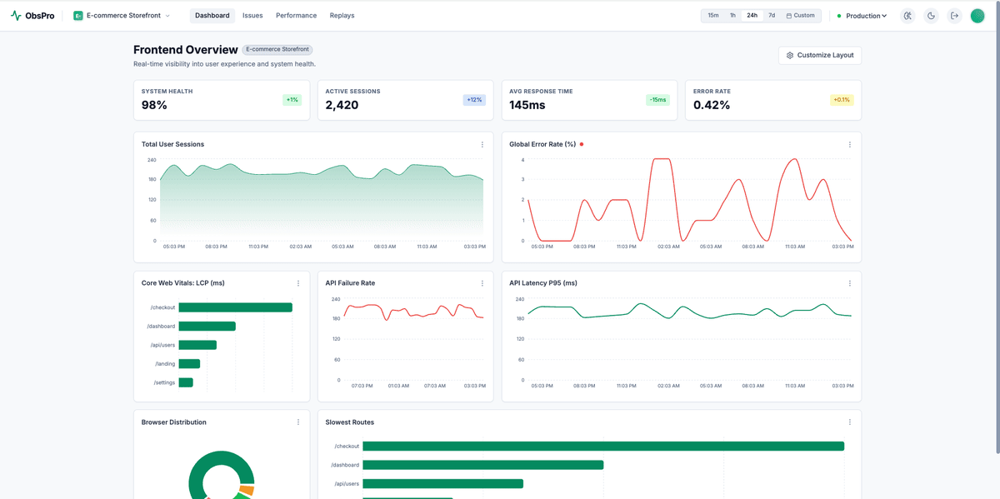

# Web page monitor

A monitoring SaaS platform: a browser SDK, a GraphQL ingestion API, and a dashboard.




| Directory    | What it is                                                     |
| ------------ | -------------------------------------------------------------- |
| `sdk/`       | Browser SDK (`monitor.js`) — collects and batches events       |
| `backend/`   | Apollo Server + Express API on Prisma/MySQL, single `/graphql` |
| `dashboard/` | React + Vite dashboard, live off the GraphQL API                |
| `examples/`  | Runnable demos per monitoring layer — see `examples/README.md` |

`sdk/`, `backend/` and `dashboard/` each install their own dependencies;
`examples/` is plain source you copy from. The root holds only repository-wide
pieces: `docker-compose.yml` for the full stack, and the ESLint and Prettier
config shared by all three (`npm install` at the root is tooling only — it does
not build or run anything).

## Running the whole stack

```bash
cp .env.example .env          # set JWT_SECRET (32+ chars) at minimum
docker compose up --build     # dashboard :8080, API :4000, MySQL
```

The API container applies migrations on start. `backend/docker-compose.yml` is
the development counterpart — MySQL alone, so the API can run from source.

## Backend

```bash
cd backend
npm install
docker compose up -d      # mysql:8 on :3306, db monitoring_saas
cp .env.example .env
npm run db:migrate        # prisma migrate dev
npm run dev
```

`src/lib/env.ts` validates every variable at boot, so misconfiguration fails
fast — `JWT_SECRET` must be at least 32 characters. Sessions are tuned with
`ACCESS_TOKEN_TTL` (default `24h`) and `REFRESH_TOKEN_TTL_DAYS` (default `30`);
ingest volume with `INGEST_EVENTS_PER_MINUTE` (default `6000`, per key), query
shape with `MAX_QUERY_DEPTH` (default `12`), and background work with
`RETENTION_DAYS` (default `90`), `ALERTS_ENABLED` and `ALERT_INTERVAL_SECONDS`.

GraphQL at http://localhost:4000/graphql. Two probes: `/health` is liveness and
never touches the database (a restart cannot fix an outage), `/ready` pings it
and returns 503 when it is unreachable.

Also: `npm run build`, `npm start`, `npm run db:studio`, `npm test`, `npm run typecheck`.

`register` creates a tenant with a default API key — read keys via the `apiKeys`
query or the dashboard's Projects page. The SDK sends it as `X-API-Key`.

An ingest key is readable by anyone who views the page source it ships in, so a
key can be pinned to the origins it may report from, on the Projects page or via
`setApiKeyAllowedOrigins`. A key with an allowlist rejects every other origin —
including a request with no `Origin` header at all, which is what a key replayed
outside a browser looks like. A key with an empty allowlist accepts any origin,
which is how keys are created.

## Dashboard

```bash
cd dashboard
npm install
cp .env.example .env.local   # API_URL, plus GEMINI_API_KEY for the AI panel only
npm run dev                  # http://localhost:3000
```

Sign-up lands on **Projects**, where each project is an API key with a copyable
install snippet and its origin allowlist; **Dashboards** opens the Dashboard /
Issues / Performance / Replays / Alerts views. Replays is sample data, labeled as
such in the UI; the rest is live.

## SDK

Four monitoring layers, all reported to one endpoint:

1. **Page performance** — navigation timing (DNS, TCP, TTFB, DOM, load) and Web Vitals (FCP, LCP, CLS, FID); LCP/CLS/FID finalize when the page is hidden.
2. **Errors** — JS exceptions, unhandled rejections and resource failures; `fetch` and `XMLHttpRequest` are instrumented, so any HTTP ≥ 400 or network failure is captured with no manual code.
3. **Business flows** — `startFlow` tracks a journey, reporting `completed`, `failed`, `timeout` or `abandoned` with per-step timings.
4. **Custom** — `captureCustomEvent` and `captureMetric`, tagged with the current user and session.

```js
import MonitoringSDK from '@web-monitor/sdk'   // or <script type="module" src="monitor.js">

const monitor = new MonitoringSDK('sk_your_api_key_here', {
	baseUrl: 'https://api.yourmonitoring.com',
	batchSize: 10, // events per batch
	flushInterval: 5000, // ms between flushes
	sampleRate: 1, // fraction of page loads reporting performance (errors are never sampled)
	maxQueueSize: 200, // events held before the oldest are dropped
	maxErrorRepeats: 10, // per-page cap on identical errors, so a loop can't flood ingestion
	flowTimeout: 30000, // default business-flow timeout in ms
	instrumentFetch: true,
	instrumentXhr: true,
	maxRetryDelay: 300000, // ceiling for backoff after failed flushes
})

monitor.setUser('user_12345')
monitor.captureError(err, { feature: 'checkout' })
monitor.captureCustomEvent('user_signup', { plan: 'pro' })
monitor.captureMetric('search_latency_ms', 420, { page: 'inbox' })
```

### Business flows

```js
const flow = monitor.startFlow('patient_first_message', {
	timeout: 60000, // unfinished after 60s → reported as `timeout`
	context: { patientId, clinicId },
})

flow.step('message_sent')
flow.step('doctor_assigned', { doctorId })
flow.complete() // or flow.fail('unread_badge_missing')
```

Each flow emits one `business_flow` event — final status, every step with its
offset, the last step reached, total duration — enough to answer "what fraction
of first messages got a doctor within 60 seconds, and where did the rest stop?".

For React usage (provider, `useMonitoring`, `useFlow`) see `examples/react-integration.jsx`.

Failed flushes are re-queued and retried with exponential backoff; batches the
API rejects outright (bad key, invalid payload) are dropped rather than retried
forever.

## Alerts

Rules are evaluated on a timer against the window ending now — never on the
ingest path, so a burst of 500 errors costs one evaluation rather than 500.
Four conditions:

| Condition      | Fires when                                          | Threshold unit |
| -------------- | --------------------------------------------------- | -------------- |
| `NewIssue`     | An error hash is seen for the first time            | — |
| `ErrorSpike`   | Occurrences in the window exceed the threshold      | occurrences |
| `ErrorRate`    | Errors exceed that share of all events              | percent |
| `SlowPageLoad` | Average load time over the window exceeds it        | milliseconds |

Each rule has a cooldown, so a condition that stays true alerts once rather than
on every sweep. `ErrorRate` ignores windows under 20 events and `SlowPageLoad`
under 5 samples, where the numbers are noise rather than signal. A rule may carry
a webhook URL; the notification is recorded either way, so a dead webhook never
means a lost alert.

## API surface

Queries: `me`, `myTenant`, `apiKeys`, `dashboardStats`, `errors`,
`errorStatusCounts`, `errorDetails`, `errorTimeSeries`, `performanceTimeSeries`,
`webVitals`, `deviceBreakdown`, `apiErrors`, `customEvents`, `businessFlows`,
`dashboardLayouts`, `alertRules`, `alertNotifications`.

Mutations: `register`, `login`, `refreshSession`, `logout`, `changePassword`,
`createApiKey`, `revokeApiKey`, `setApiKeyAllowedOrigins`, `updateErrorStatus`,
`saveDashboardLayout`, `deleteDashboardLayout`, `createAlertRule`,
`updateAlertRule`, `deleteAlertRule`, `markAlertNotificationsRead`, and the SDK's
`ingest*` family.

Behaviour worth knowing:

-   Errors group per `(tenant, errorHash)` with hourly counts in `ErrorBucket` —
    what makes each issue's trend line real.
-   A resolved error that recurs reopens as `Regressed`.
-   Refresh tokens rotate: each `refreshSession` revokes the token it consumed,
    and changing a password revokes every session.
-   Ingest is size-capped (500 events per type per batch, plus per-field
    limits); auth mutations allow 10 attempts per 15 minutes per IP + identity.
-   Ingest is also rate limited per API key, charged by event count rather than
    request count — one batch can carry 2000 events, so counting requests would
    measure the wrong thing.
-   Each tenant has a monthly event quota (100k by default); ingestion is
    rejected past it.
-   Email is unique in the database, not just checked before insert, so two
    simultaneous sign-ups cannot both claim an address.
-   Queries deeper than `MAX_QUERY_DEPTH` are rejected during validation,
    before any resolver runs.
-   A retention sweep deletes ingested events older than `RETENTION_DAYS` in
    bounded chunks, along with refresh tokens that can no longer be redeemed.
    `ErrorLog` is exempt: it is the issue list with triage status, not raw
    event data.

## Tests

```bash
npm install && npm run lint   # ESLint across all three workspaces
cd backend   && npm test      # 91 unit tests
cd sdk       && npm test      # 25 jsdom tests
cd dashboard && npm test      # 20 jsdom tests
cd dashboard && npm run typecheck && npm run build
```

## License

MIT — see [LICENSE](LICENSE).
